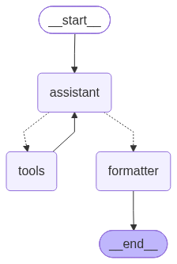
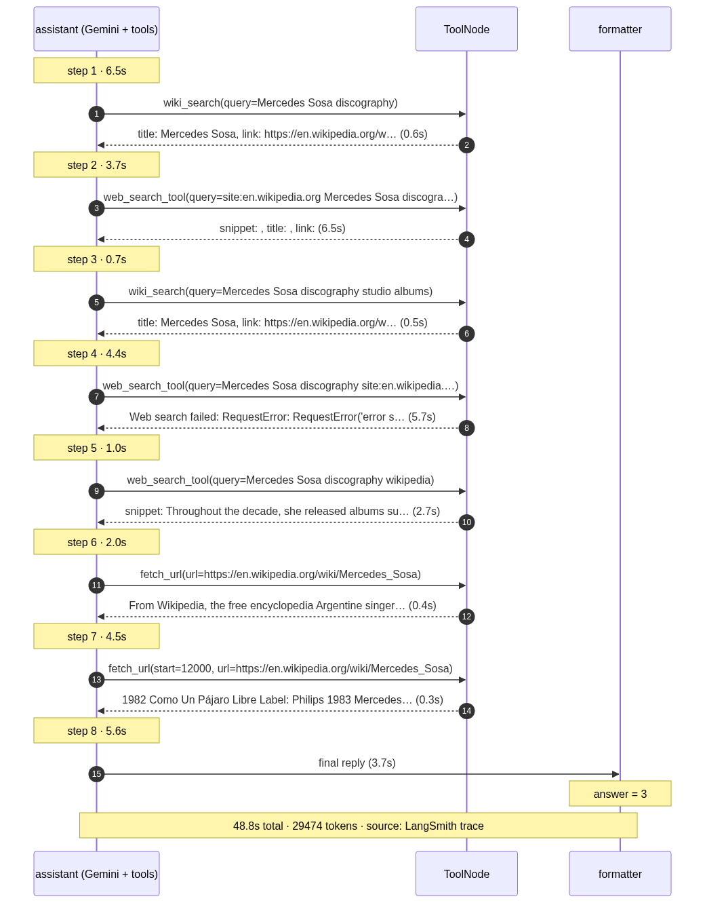

# Architecture

GAIA Level 1 agent for the Hugging Face Agents Course (Unit 4). One LLM (Gemini) in a
ReAct loop with 7 tools, a step budget, and a separate formatter for exact-match answers.

## Graph



```
START → assistant ⇄ tools (ToolNode) → formatter → END
```

| Node | What it does |
|---|---|
| `assistant` | Prepends the Plan → Act → Verify system prompt (not stored in state) and calls Gemini with tools bound. On the last step (`MAX_STEP - 1`) it calls the model **without** tools plus `LAST_STEP_NOTE`, so it must answer in text. Increments `current_step`. |
| `tools` | LangGraph `ToolNode` running whichever tools the model called. Results go back to `assistant`. |
| `formatter` | Takes the question + last reply and returns `FinalAnswerFormatter` via structured output (number / few words / comma list, no units or articles). |
| `route_decision` | `step ≥ MAX_STEP` → formatter; tool calls → tools; otherwise → formatter. |

State (`AgentState`): `messages`, `file_path` (attachment name, if any), `current_step`, `final_answer`.
`MAX_STEP = 10`.

## Execution flow (real trace)

Rendered from the LangSmith trace of *"How many studio albums were published by Mercedes Sosa
between 2000 and 2009?"* (exported steps: [`trace_8e867cd7.json`](trace_8e867cd7.json)):



What the trace shows: 8 assistant steps, 48.8 s, 29,474 tokens, correct answer `3`. It also shows
a weakness: the model ran 5 searches (one failed with a network error) before `fetch_url`
opened the Wikipedia page that held the discography table, although the prompt says to search
at most twice. Before the rule existed, the same question took 6 searches and answered `4`; with
the rule it answered correctly but still over-searched, so a small model does not follow the rule
strictly.

## Tools (`agent/tools/`)

| Tool | Backend | Notes |
|---|---|---|
| `web_search_tool(query)` | DuckDuckGo, top 5 | snippets only; prompt says to read pages with `fetch_url` |
| `wiki_search(query)` | MediaWiki API | `title, link, snippet` for top 5 |
| `fetch_url(url, start=0)` | requests → HTML→Markdown | strips nav/citations/edit links (Wikipedia page 123k → 21k chars); 12k-char chunks with `start` to continue |
| `youtube_transcript(url)` | youtube-transcript-api | `[Ns] text` lines |
| `read_file(file_path, start=0)` | pandas / text | CSV, every Excel sheet as CSV, text/code |
| `analyze_media(file_path, question)` | Gemini multimodal | image, audio, video, PDF (≤ 20 MB) |
| `run_python(task, file_path=None)` | Gemini server-side code execution | with `file_path`, the file's data is embedded in the task |

Shared guards:
- **`GEMINI_RATE_LIMITER`** (13 RPM by default): one limiter for the agent model, `analyze_media` and `run_python`.
- **`resolve_asset_path`**: file tools only read inside `assets/` (`../.env` is rejected).
- **Every tool catches its own exceptions** and returns an error string, because `ToolNode` would otherwise crash the graph.
- **`truncate`** caps every tool output and tells the model the next `start` offset.

## Around the graph

| File | Role |
|---|---|
| `gaia_api.py` | `/questions`, attachment download (falls back to the GAIA dataset on the Hub when `/files` returns 404), `/submit` |
| `run_eval.py` | CLI: `run [--task ID]`, `show`, `submit`. Caches answers in `cache/answers.json`; attaches LangSmith run name, tags and metadata to each question |
| `app.py` | Course Gradio runner using `GaiaAgent` (needs a Gradio Space; this Space is static) |
| `langgraph.json` | LangGraph Studio entry (`langgraph dev`) |
| `tests/` | 31 offline tests; network and Gemini are faked, LangSmith tracing disabled |

## Observability

With `LANGSMITH_TRACING=true` every question becomes one trace named `gaia-<task_id[:8]>`, tagged
`gaia`, the model name and `has-file`, with metadata `task_id`, `file_name`, `model`, `max_step`
and `prompt_version` (first 8 hex chars of the SHA-1 of the system prompt, so prompt edits are
comparable without manual versioning).

## Configuration

| Variable | Default | Purpose |
|---|---|---|
| `GOOGLE_API_KEY` | required | Gemini |
| `HF_TOKEN` | needed for attachments | gated GAIA dataset fallback |
| `GEMINI_MODEL` | `gemini-3.5-flash-lite` | model for agent and tools |
| `GEMINI_RPM` | `13` | shared rate limit |
| `LANGSMITH_TRACING`, `LANGSMITH_API_KEY`, `LANGSMITH_PROJECT` | off | tracing |

Regenerate the images with `python docs/make_diagrams.py graph` and
`python docs/make_diagrams.py trace docs/trace_8e867cd7.json`.
